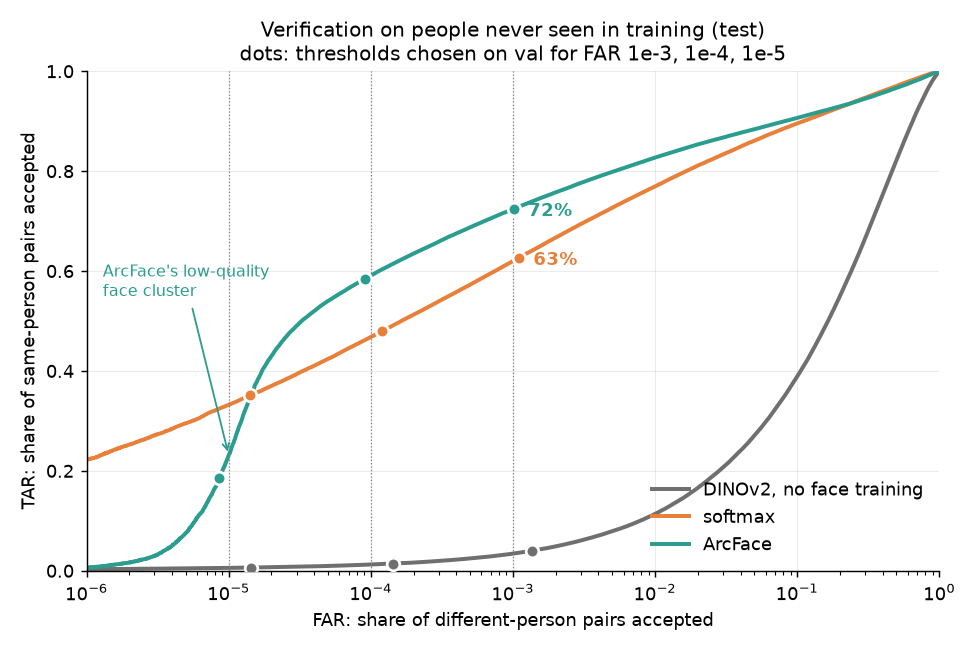
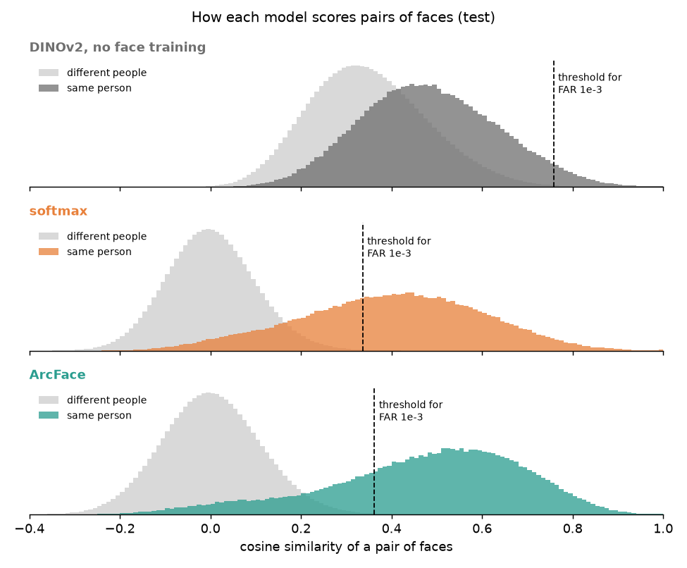
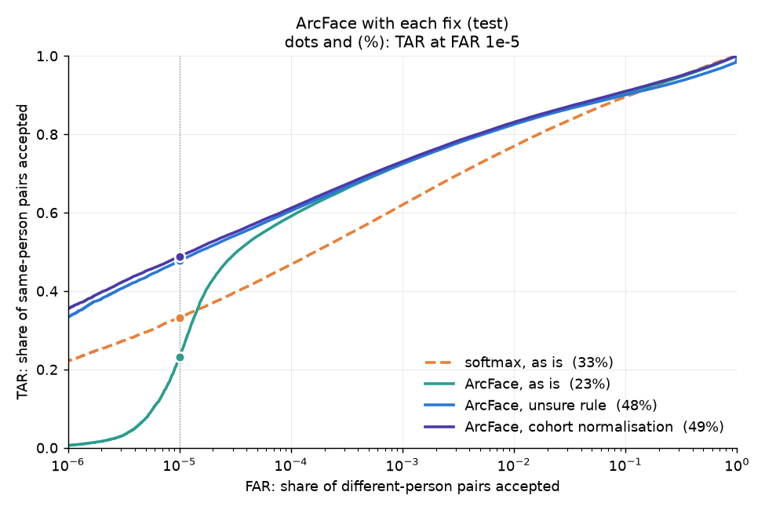

# I Use Arc BTW
Exploration of how ArcFace is implementated and a comparison of ArcFace classifier vs softmax on a small training run using DINOv2 S backbone.


## Roadmap

- [x] 0. Environment: PyTorch on an RTX 5060 Ti (Blackwell, `sm_120`)
- [x] 1. Load DINOv2 and inspect its outputs
- [x] 2. Embedding neck on top of the backbone
- [x] 3. Softmax head (baseline)
- [x] 4. ArcFace head
- [x] 5. Toy 2D experiment: softmax vs ArcFace feature geometry
- [x] 6. Face dataset and identity-disjoint split
- [x] 7. Training loop
- [x] 8. Verification evaluation on unseen identities
- [x] 9. Compare softmax vs ArcFace

## Method

- **Model.** A pretrained DINOv2 ViT-S/14 backbone with a small neck (Linear +
  BatchNorm) that turns each face photo into a 384-number embedding.
- **Two heads, trained separately.** A plain softmax classifier, and ArcFace
  (s = 64, m = 0.5). ArcFace scores a photo by its angle to each identity and
  adds 0.5 radians (about 29°) to the angle to its own identity, so the model
  has to beat every other identity by that margin. Everything else is the same
  for both: data, data order, seed, optimiser and 10 epochs. After training the
  head is thrown away and only the embedding is used.
- **Data.** CASIA-WebFace, split by person: 9,072 people for training, 500 for
  validation (val) and 1,000 for test. Val and test people are never seen in
  training.
- **Verification.** Two photos are called the same person when the cosine
  between their embeddings is above a threshold. Every pair of photos is scored,
  with up to 20 photos per person (177M pairs on test). The measure is TAR at a
  fixed FAR: the share of same-person pairs accepted when the threshold lets
  through 1 in 1,000, 10,000 or 100,000 pairs of different people (FAR 1e-3,
  1e-4 and 1e-5).
- **Testing fairly.** Thresholds and settings were chosen on val, and
  predictions were written down and committed before test was used. Ranges in
  brackets after a difference are 95% intervals from resampling the test people
  1,000 times.

## Results

### Softmax vs ArcFace



| test, TAR at | FAR 1e-3 | FAR 1e-4 | FAR 1e-5 |
|---|---|---|---|
| DINOv2, no face training | 3.4% | 1.2% | 0.6% |
| softmax | 62.0% | 46.8% | **33.2%** |
| ArcFace | **72.4%** | **59.1%** | 23.1% |

ArcFace is ahead by 10.4 points [+9.9, +10.9] at FAR 1e-3 and 12.3 points
[+11.2, +13.3] at FAR 1e-4. The margin pulls each person's photos closer
together, so more same-person pairs clear the threshold:



The exception is FAR 1e-5, where softmax is ahead by 10.1 points, though not
clearly: the interval [-4.9, +22.6] crosses 0. Details in
[docs/softmax_vs_arcface.md](docs/softmax_vs_arcface.md).

Along the way, ArcFace with m = 0.5 can collapse early in training by pushing
every face away from every identity at once. A short test run fell into this.
The full run, with its longer warm-up, did not
([docs/arcface_trap.md](docs/arcface_trap.md)).

### Why ArcFace needed fixing at FAR 1e-5

At FAR 1e-5 only a handful of different-person pairs get through, so a few
photos decide the result. For ArcFace they are unreadable photos: blurred,
side-on or partly covered. On val, ArcFace's 450 highest-scoring
different-person pairs involve just 51 photos. ArcFace puts unreadable photos
of different people in the same place (cosines up to 0.96), so the threshold
has to rise to 0.666 to keep them out, and most same-person pairs fall below
it. Softmax doesn't do this. [Deng et al. (WACV 2023)](https://openaccess.thecvf.com/content/WACV2023/papers/Deng_Harnessing_Unrecognizable_Faces_for_Improving_Face_Recognition_WACV_2023_paper.pdf)
found the same cluster in other face models. Details in
[docs/low_quality_direction.md](docs/low_quality_direction.md).

### The fixes

Neither fix retrains the model. Both only change how a pair's cosine becomes a
yes or no, are built from training photos and were tuned on val. They were
tested separately.

- **Unsure rule** (Deng et al.). Ruin 9,072 training photos (shrink to 8×8
  pixels, blur heavily or cover half the face) and average their embeddings.
  That gives the model's "can't tell who this is" direction. A photo pointing
  along it (cosine above 0.25 for ArcFace, the top 1% of val photos) is marked
  unsure, and any pair containing it is rejected.
- **Cohort normalisation** (AS-norm). Compare each photo with 18,144 training
  photos and keep its 300 highest cosines. Their mean and spread show how freely
  the photo matches strangers. A pair's new score is how far its cosine sits
  above each photo's usual scores with strangers, measured in spreads and
  averaged over the two photos. Unreadable photos have a wide spread, so their
  high cosines count for less.



| test, TAR at | FAR 1e-3 | FAR 1e-4 | FAR 1e-5 |
|---|---|---|---|
| softmax | 62.0% | 46.8% | 33.2% |
| ArcFace | 72.4% | 59.1% | 23.1% |
| ArcFace, unsure rule | 72.5% | 60.4% | 47.8% |
| ArcFace, cohort normalisation | **73.0%** | **61.1%** | **48.8%** |

Both fixes roughly double ArcFace's TAR at FAR 1e-5 (+24.7 points
[+10.0, +37.4] and +25.6 [+11.2, +38.1]) and change little elsewhere. ArcFace
is now ahead of softmax at every FAR, by 10.5 to 15.5 points, and no interval
comes near 0. Softmax doesn't need fixing: neither fix moves it by more than 3
points. Every prediction made on val held on test. Details in
[docs/further_work/low_quality_fixes.md](docs/further_work/low_quality_fixes.md).

### Limits

- One training run per head, so the effect of a different seed isn't measured.
- One small setting (ViT-S, CASIA-WebFace, 10 epochs), not a standard benchmark
  such as LFW.
- Why ArcFace groups unreadable photos together and softmax doesn't is still
  open.

## Setup

```bash
uv sync
uv run scripts/check_env.py
```
