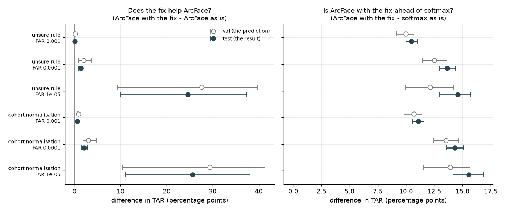
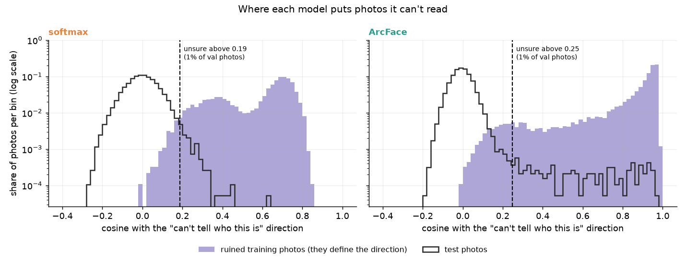

# Further work: fixing ArcFace at the strictest setting

This goes beyond the roadmap (steps 0-9). It asks whether ArcFace's one weak
result in step 9 can be fixed without retraining the model.

**Result.** Both fixes work on test (1,000 people neither model has seen). At
FAR 1e-5, where the threshold lets through 1 in 100,000 pairs of different
people, ArcFace accepted 23.1% of same-person pairs in step 9. With the unsure
rule it accepts 47.8%, and with cohort normalisation 48.8%. Softmax as is
accepts 33.2%, so ArcFace is now ahead at every setting, by 10.5 to 15.5
points. Neither fix costs ArcFace anything at the looser settings, and softmax
didn't need either: neither moved it by 3 points.


Each line is one model and scoring rule on test. Further right, more pairs of
different people get through (FAR, log scale), and so do more same-person pairs
(TAR). Higher is better. The dots are at FAR 1e-5, and the legend gives their
TAR. ArcFace as is (teal) falls away below FAR 1e-4, where its threshold has to
climb over the pairs of unreadable photos. With either fix, ArcFace stays above
softmax down to FAR 1e-6.

## The problem

- **How a pair is decided.** Two photos are called the same person when the
  cosine between their embeddings is above a threshold. At FAR 1e-5, the
  threshold is set so that 1 in 100,000 pairs of different people get through.
- **Softmax was ahead there.** At FAR 1e-5, softmax accepted 33.2% of
  same-person pairs on test, against ArcFace's 23.1%
  ([softmax_vs_arcface.md](../softmax_vs_arcface.md)). On val it was 32.3% against 16.9%.
- **The cause** ([low_quality_direction.md](../low_quality_direction.md)). On
  val, all 450 different-person pairs that get through for ArcFace involve the
  same 51 photos. They are unreadable: blurred, side-on, partly covered. ArcFace
  puts unreadable photos of *different* people in the same place, so they match
  each other, at cosines up to 0.96. To keep them out, the threshold has to sit
  at 0.666, and most same-person pairs fall below it.
- **This is known.** [Deng et al. (WACV 2023)](https://openaccess.thecvf.com/content/WACV2023/papers/Deng_Harnessing_Unrecognizable_Faces_for_Improving_Face_Recognition_WACV_2023_paper.pdf)
  found the same clump of "unrecognisable identities" in other face models.

Both fixes below leave the model as it is. They change only how a pair's cosine
becomes a yes or no.

## Fix 1: the unsure rule (Deng et al.)

1. Take 9,072 training photos (one per training person) and ruin each one:
   shrink it to 8x8 pixels, blur it heavily, or cover half the face with a grey
   block.
2. Embed them. ArcFace points nearly all of them the same way: their median
   cosine with their average direction is 0.93. That average is the model's
   direction for "can't tell who this is". Normal photos sit at right angles to
   it (cosine about 0).
3. Set a cutoff on val: the cosine with that direction above which the top 1%
   of val photos sit. For ArcFace it is 0.25.
4. When verifying, a photo above the cutoff is "unsure", and any pair containing
   it is answered "different", as a deployed system would ask for a better
   photo. These pairs still count: a same-person pair answered "different" is a
   miss.


Each panel shows photos by their cosine with that model's "can't tell who this
is" direction. Purple: the 9,072 ruined training photos. Black outline: val
photos, up to 20 per val person. The vertical axis is a log scale, so the few
val photos far to the right still show. The dashed line is the cutoff, and
photos to its right are unsure.

- **ArcFace (right):** most ruined photos sit above 0.9, and a thin tail of val
  photos reaches up there with them. Those are its unreadable val photos.
- **Softmax (left):** its ruined photos spread from about 0 to 0.85 (median
  0.66), and no val photo gets past about 0.42. Softmax's real photos don't line
  up with its ruined ones.

On val, ArcFace's highest-scoring pair of different people has a cosine of 0.957,
well above 0.666, so it is accepted as is. But its two photos' cosines with the
"can't tell who this is" direction are 0.94 and 0.93, above 0.25, so the rule
answers "unsure" and the pair is rejected.

## Fix 2: cohort normalisation

A cosine of 0.6 means different things for different photos. From a photo that
rarely matches strangers, it is strong evidence. From a photo that matches lots
of strangers, it is weak. This is adaptive score normalisation (AS-norm), as used
in speaker verification.

1. **The cohort:** 18,144 training photos, 2 per training person. They are
   strangers to every val and test photo.
2. **Each photo being verified** is compared with all 18,144. Its 300 highest
   cosines give two numbers: their **mean** (how well it matches its closest
   strangers) and their **spread** (standard deviation).
3. **Each pair is rescored:**
   ½ × [ (cosine − mean_A) / spread_A + (cosine − mean_B) / spread_B ],
   i.e. how many spreads the cosine sits above each photo's usual score with
   strangers, averaged over the two photos.
4. **A new threshold** is chosen on val the same way as before. For ArcFace at
   FAR 1e-5 it is 5.53.

Two pairs from val (ArcFace):

| | cosine | as is (threshold 0.666) | photo A | photo B | new score | after (threshold 5.53) |
|---|---|---|---|---|---|---|
| highest-scoring pair of different people | 0.957 | accepted | (0.957 − 0.393) / 0.276 = +2.04 | +2.06 | +2.05 | rejected |
| a same-person pair | 0.581 | rejected | (0.581 − 0.278) / 0.039 = +7.78 | +8.52 | +8.15 | accepted |

In these two pairs, the unreadable photos' spread is about 7 times the clear
photos', so their scores shrink. A clear photo's small spread makes a modest
genuine cosine stand out.

## Predictions vs result



Each circle is a difference in TAR, in percentage points, and its bar is the
middle 95% of 1,000 resamples of that split's people. Hollow: val, where the
predictions came from. Filled: test. Left: ArcFace with the fix minus ArcFace
as is. Right: ArcFace with the fix minus softmax as is. No interval crosses 0.
The FAR 1e-5 gains on the left are wide (about +10 to +38) but stay well clear
of 0.

### Predictions, written from val before test was used

1. The unsure rule lifts ArcFace's TAR at FAR 1e-5, with an interval that never
   crosses 0. On val: +27.6 points [+9.3, +39.8]. It doesn't hurt at FAR 1e-3
   or 1e-4 (on val: +0.2 and +2.0).
2. Cohort normalisation does the same. On val: +29.4 [+10.4, +41.4] at FAR 1e-5,
   and +0.9 and +3.0 at FAR 1e-3 and 1e-4.
3. With either fix, ArcFace beats softmax as is at every FAR, 1e-5 included,
   with intervals that never cross 0. On val, with the unsure rule: +10.0, +12.5
   and +12.2 at FAR 1e-3, 1e-4 and 1e-5. With cohort normalisation: +10.7, +13.6
   and +13.9.
4. Softmax doesn't need fixing: neither fix changes its TAR by 3 points or more
   at any FAR. On val, the unsure rule changes it by -0.3, -0.2 and -0.1, and
   cohort normalisation by +1.7, +2.0 and +1.9. Softmax's false matches aren't
   concentrated on a few photos (on test, its 1,768 highest-scoring
   different-person pairs involve 2,034 photos), so there is little for either
   fix to remove.
5. Val's settings carry over. The unsure cutoff flags between 0.5% and 2% of
   test photos. At FAR 1e-3 and 1e-4, test's FAR is within a factor of 2 of the
   target for every model and fix.

These were committed before test was used (01c949c, with prediction 3 switched
to softmax as is in e27404f). All five held:

1. +24.7 [+10.0, +37.4] at FAR 1e-5. At FAR 1e-3 and 1e-4: +0.1 [+0.0, +0.1]
   and +1.4 [+0.8, +2.1].
2. +25.6 [+11.2, +38.1] at FAR 1e-5. At FAR 1e-3 and 1e-4: +0.6 [+0.5, +0.7]
   and +2.1 [+1.5, +2.9].
3. With the unsure rule: +10.5, +13.6 and +14.6. With cohort normalisation:
   +11.1, +14.3 and +15.5. The lowest end of any of these intervals is +10.0.
4. The unsure rule changed softmax by -0.4, -0.2 and -0.1, and cohort
   normalisation by +1.8, +2.4 and +2.7. The last is the closest call of the five.
5. The cutoff flagged 0.8% of test photos for ArcFace and 1.1% for softmax.
   Test's FAR was 0.9x to 1.2x the target at FAR 1e-3 and 1e-4, for every model
   and fix.

The worked examples carry over too. On test, ArcFace's highest-scoring pair of
different people has a cosine of 0.964. Both its photos sit at 0.95 to the
"can't tell who this is" direction, so the unsure rule rejects the pair, and
cohort normalisation scores it +2.05, below 5.53. At val's FAR 1e-5 thresholds,
51,124 test same-person pairs are rejected as is and accepted after cohort
normalisation.

<details>
<summary>Val's figures, which the predictions were written from</summary>


</details>

## Numbers

TAR on test at test's own thresholds (as in step 9):

| | TAR @ FAR 1e-3 | 1e-4 | 1e-5 |
|---|---|---|---|
| softmax, as is | 62.0% | 46.8% | 33.2% |
| softmax, unsure rule | 61.6% | 46.6% | 33.1% |
| softmax, cohort normalisation | 63.8% | 49.2% | 35.9% |
| ArcFace, as is | 72.4% | 59.1% | 23.1% |
| ArcFace, unsure rule | 72.5% | 60.4% | 47.8% |
| ArcFace, cohort normalisation | **73.0%** | **61.1%** | **48.8%** |

<details>
<summary>Thresholds chosen on val, applied to test</summary>

Thresholds are cosines, except for cohort normalisation, where they are
rescored values.

| | chosen for | threshold | test FAR | test TAR |
|---|---|---|---|---|
| softmax, as is | FAR 1e-3 | 0.336 | 1.1e-3 | 62.7% |
| | FAR 1e-4 | 0.415 | 1.2e-4 | 47.9% |
| | FAR 1e-5 | 0.483 | 1.4e-5 | 35.1% |
| softmax, unsure rule | FAR 1e-3 | 0.336 | 1.1e-3 | 62.3% |
| | FAR 1e-4 | 0.415 | 1.2e-4 | 47.7% |
| | FAR 1e-5 | 0.483 | 1.4e-5 | 35.0% |
| softmax, cohort normalisation | FAR 1e-3 | 1.800 | 1.0e-3 | 64.1% |
| | FAR 1e-4 | 3.696 | 1.1e-4 | 49.6% |
| | FAR 1e-5 | 5.274 | 1.1e-5 | 36.6% |
| ArcFace, as is | FAR 1e-3 | 0.362 | 1.0e-3 | 72.5% |
| | FAR 1e-4 | 0.453 | 9.0e-5 | 58.4% |
| | FAR 1e-5 | 0.666 | 8.6e-6 | 18.5% |
| ArcFace, unsure rule | FAR 1e-3 | 0.361 | 1.0e-3 | 72.6% |
| | FAR 1e-4 | 0.442 | 9.8e-5 | 60.3% |
| | FAR 1e-5 | 0.514 | 9.2e-6 | 47.3% |
| ArcFace, cohort normalisation | FAR 1e-3 | 1.896 | 1.0e-3 | 73.1% |
| | FAR 1e-4 | 3.858 | 9.9e-5 | 61.1% |
| | FAR 1e-5 | 5.526 | 9.7e-6 | 48.6% |

As is, ArcFace's FAR 1e-5 threshold (0.666) was pushed up by val's own
unreadable photos. On test it lets through fewer different-person pairs than
targeted (8.6e-6), and accepts 18.5% of same-person pairs where 23.1% was
possible. With either fix, val's threshold lands close to the target on test
(9.2e-6 and 9.7e-6), and its TAR is within 0.5 points of the best possible
(47.3% against 47.8%, and 48.6% against 48.8%).

</details>

<details>
<summary>The unsure rule on test photos</summary>



The same as the figure in Fix 1, with test photos in place of val. The cutoffs
are val's. ArcFace's thin tail of unreadable photos is there on test too, and
the cutoff flags 0.8% of test photos. For softmax, a photo near 0.64 gets
further than any val photo did, and 1.1% are flagged.

</details>

## How they are compared

- **Test is used once.** Everything was developed on val, with
  `--eval-split val`, and the predictions were committed first.
- **Ruined photos:** one per training person, each given one of the three
  corruptions at random, with a fixed seed.
- **Unsure cutoff:** the cosine that 1% of val photos reach. 0.247 for ArcFace,
  0.186 for softmax. On test it is used as a fixed number, so the share of test
  photos it flags is part of the result.
- **Cohort:** 18,144 training photos; each photo's 300 highest cosines.
- **Thresholds come from val** for the worked examples and the thresholds table.
  The headline table, the ROC figure's dots and the TAR differences use each
  split's own threshold instead, set again on each split and each resample at
  exactly the target FAR, as in step 9.
- **Softmax is scored with both fixes too,** to check it doesn't need them
  (prediction 4). ArcFace with each fix is compared with softmax as is, the
  baseline from step 9.
- **A paired bootstrap over people** gives the intervals: 1,000 resamples of
  the split's identities, with every model scored on the same resample, as in
  step 9.

## What it doesn't show

- **Which fix is better.** On test they are within about 1 point of each other
  at every FAR, and they weren't compared head to head. The unsure rule is
  cheaper: one cosine per photo, against 18,144 for cohort normalisation, which
  also has to keep the cohort.
- **Both fixes together.** Not tried.
- **Why ArcFace forms the cluster and softmax doesn't.** The fixes remove the
  symptom. Softmax's ruined photos also point a common way (median cosine 0.66),
  but its real unreadable photos don't follow them (the figure in Fix 1). Why
  is still open.
- **Training randomness.** There is one training run per head, as in step 9.

## Reproduce

```bash
uv run scripts/further_work/low_quality_fixes.py --eval-split val   # development, about 4 minutes; writes docs/img/further_work/val_*.png
uv run scripts/further_work/low_quality_fixes.py                    # test, about 15 minutes; writes docs/img/further_work/test_*.png
```
