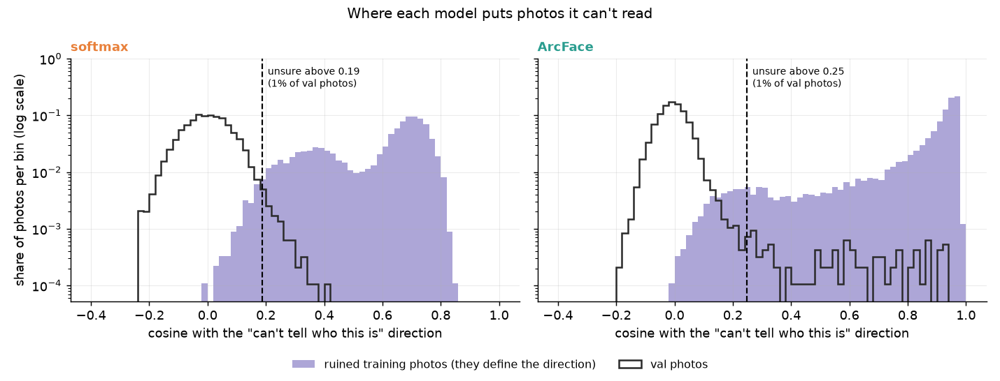
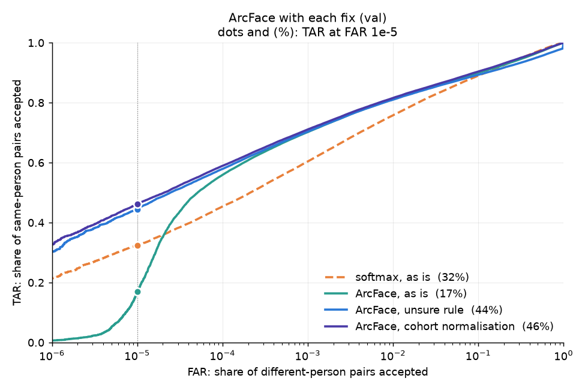
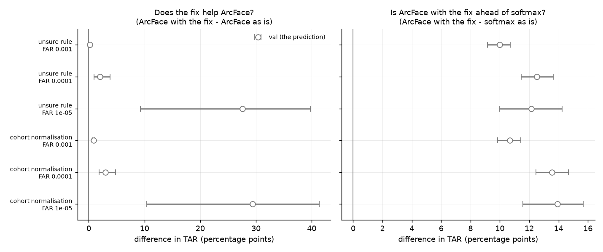

# Further work: fixing ArcFace at the strictest setting

This goes beyond the roadmap (steps 0-9). It asks whether ArcFace's one weak
result in step 9 can be fixed without retraining the model.

## The problem

- **How a pair is decided.** Two photos are called the same person when the
  cosine between their embeddings is above a threshold. At FAR 1e-5, the
  threshold is set so that 1 in 100,000 pairs of different people get through.
- **Softmax was ahead there.** At FAR 1e-5, softmax accepted 33.2% of
  same-person pairs on test, against ArcFace's 23.1%
  ([softmax_vs_arcface.md](../softmax_vs_arcface.md)). On val it was 32.3% against 16.9%.
- **The cause** ([low_quality_direction.md](../low_quality_direction.md)). On
  val, all 450 different-person pairs that get through for ArcFace involve the
  same 51 photos. They are unreadable: blurred, side-on, partly covered. ArcFace
  puts unreadable photos of *different* people in the same place, so they match
  each other, at cosines up to 0.96. To keep them out, the threshold has to sit
  at 0.666, and most same-person pairs fall below it.
- **This is known.** [Deng et al. (WACV 2023)](https://openaccess.thecvf.com/content/WACV2023/papers/Deng_Harnessing_Unrecognizable_Faces_for_Improving_Face_Recognition_WACV_2023_paper.pdf)
  found the same clump of "unrecognisable identities" in other face models.

Both fixes below leave the model as it is. They change only how a pair's cosine
becomes a yes or no.

## Fix 1: the unsure rule (Deng et al.)

1. Take 9,072 training photos (one per training person) and ruin each one:
   shrink it to 8x8 pixels, blur it heavily, or cover half the face with a grey
   block.
2. Embed them. ArcFace points nearly all of them the same way: their median
   cosine with their average direction is 0.93. That average is the model's
   direction for "can't tell who this is". Normal photos sit at right angles to
   it (cosine about 0).
3. Set a cutoff on val: the cosine with that direction above which the top 1%
   of val photos sit. For ArcFace it is 0.25.
4. When verifying, a photo above the cutoff is "unsure", and any pair containing
   it is answered "different", as a deployed system would ask for a better
   photo. These pairs still count: a same-person pair answered "different" is a
   miss.



Each panel shows photos by their cosine with that model's "can't tell who this
is" direction. Purple: the 9,072 ruined training photos. Black outline: val
photos, up to 20 per val person. The vertical axis is a log scale, so the few
val photos far to the right still show. The dashed line is the cutoff, and
photos to its right are unsure.

- **ArcFace (right):** most ruined photos sit above 0.9, and a thin tail of val
  photos reaches up there with them. Those are its unreadable val photos.
- **Softmax (left):** its ruined photos spread from about 0 to 0.85 (median
  0.66), and no val photo gets past about 0.42. Softmax's real photos don't line
  up with its ruined ones.

On val, ArcFace's highest-scoring pair of different people has a cosine of 0.957,
well above 0.666, so it is accepted as is. But its two photos' cosines with the
"can't tell who this is" direction are 0.94 and 0.93, above 0.25, so the rule
answers "unsure" and the pair is rejected.

## Fix 2: cohort normalisation

A cosine of 0.6 means different things for different photos. From a photo that
rarely matches strangers, it is strong evidence. From a photo that matches lots
of strangers, it is weak. This is adaptive score normalisation (AS-norm), as used
in speaker verification.

1. **The cohort:** 18,144 training photos, 2 per training person. They are
   strangers to every val and test photo.
2. **Each photo being verified** is compared with all 18,144. Its 300 highest
   cosines give two numbers: their **mean** (how well it matches its closest
   strangers) and their **spread** (standard deviation).
3. **Each pair is rescored:**
   ½ × [ (cosine − mean_A) / spread_A + (cosine − mean_B) / spread_B ],
   i.e. how many spreads the cosine sits above each photo's usual score with
   strangers, averaged over the two photos.
4. **A new threshold** is chosen on val the same way as before. For ArcFace at
   FAR 1e-5 it is 5.53.

Two pairs from val (ArcFace):

| | cosine | as is (threshold 0.666) | photo A | photo B | new score | after (threshold 5.53) |
|---|---|---|---|---|---|---|
| highest-scoring pair of different people | 0.957 | accepted | (0.957 − 0.393) / 0.276 = +2.04 | +2.06 | +2.05 | rejected |
| a same-person pair | 0.581 | rejected | (0.581 − 0.278) / 0.039 = +7.78 | +8.52 | +8.15 | accepted |

In these two pairs, the unreadable photos' spread is about 7 times the clear
photos', so their scores shrink. A clear photo's small spread makes a modest
genuine cosine stand out.

## Settings, fixed on val

- **Ruined photos:** one per training person, each given one of the three
  corruptions at random, with a fixed seed.
- **Unsure cutoff:** the cosine that 1% of val photos reach. 0.247 for ArcFace,
  0.186 for softmax. On test it is used as a fixed number, so the share of test
  photos it flags is part of the result.
- **Cohort:** 18,144 training photos; each photo's 300 highest cosines.
- **Thresholds:** chosen on val for each FAR and carried over to test.
- **Softmax is scored with both fixes too,** to check it doesn't need them
  (prediction 4). ArcFace with each fix is compared with softmax as is, the
  baseline from step 9.
- **Intervals:** a paired bootstrap over people, as in step 9.

<details>
<summary>Thresholds chosen on val</summary>

| | FAR 1e-3 | FAR 1e-4 | FAR 1e-5 |
|---|---|---|---|
| softmax, as is (cosine) | 0.336 | 0.415 | 0.483 |
| softmax, unsure rule (cosine) | 0.336 | 0.415 | 0.483 |
| softmax, cohort normalisation | 1.800 | 3.696 | 5.274 |
| ArcFace, as is (cosine) | 0.362 | 0.453 | 0.666 |
| ArcFace, unsure rule (cosine) | 0.361 | 0.442 | 0.514 |
| ArcFace, cohort normalisation | 1.896 | 3.858 | 5.526 |

</details>

## Predictions, written from val before test was used

On val, both fixes lift ArcFace's TAR at FAR 1e-5 from 17% to 44-46%, above
softmax's 32%.



Each line is one model and scoring rule on val. Further right, more pairs of
different people get through (FAR, log scale), and so do more same-person pairs
(TAR). The dots are at FAR 1e-5, and the legend gives their TAR. ArcFace as is
(teal) falls away below FAR 1e-4: there its threshold has to climb over the pairs
of unreadable photos. With either fix it stays high, as softmax does.



Each circle is a difference in TAR, in percentage points, and its bar is the
middle 95% of 1,000 resamples of val's people. Left: ArcFace with the fix minus
ArcFace as is. Right: ArcFace with the fix minus softmax as is. Test
will add filled points beside these.

1. The unsure rule lifts ArcFace's TAR at FAR 1e-5, with an interval that never
   crosses 0. On val: +27.6 points [+9.3, +39.8]. It doesn't hurt at FAR 1e-3
   or 1e-4 (on val: +0.2 and +2.0).
2. Cohort normalisation does the same. On val: +29.4 [+10.4, +41.4] at FAR 1e-5,
   and +0.9 and +3.0 at FAR 1e-3 and 1e-4.
3. With either fix, ArcFace beats softmax as is at every FAR, 1e-5 included,
   with intervals that never cross 0. On val, with the unsure rule: +10.0, +12.5
   and +12.2 at FAR 1e-3, 1e-4 and 1e-5. With cohort normalisation: +10.7, +13.6
   and +13.9.
4. Softmax doesn't need fixing: neither fix changes its TAR by 3 points or more
   at any FAR. On val, the unsure rule changes it by -0.3, -0.2 and -0.1, and
   cohort normalisation by +1.7, +2.0 and +1.9. Softmax's false matches aren't concentrated on a few
   photos (on test, its 1,768 highest-scoring different-person pairs involve
   2,034 photos), so there is little for either fix to remove.
5. Val's settings carry over. The unsure cutoff flags between 0.5% and 2% of
   test photos. At FAR 1e-3 and 1e-4, test's FAR is within a factor of 2 of the
   target for every model and fix.

## Results

Not run yet. Test will be used once, with the settings above.

## Reproduce

```bash
uv run scripts/further_work/low_quality_fixes.py --eval-split val   # development, about 4 minutes
uv run scripts/further_work/low_quality_fixes.py                    # test
```
