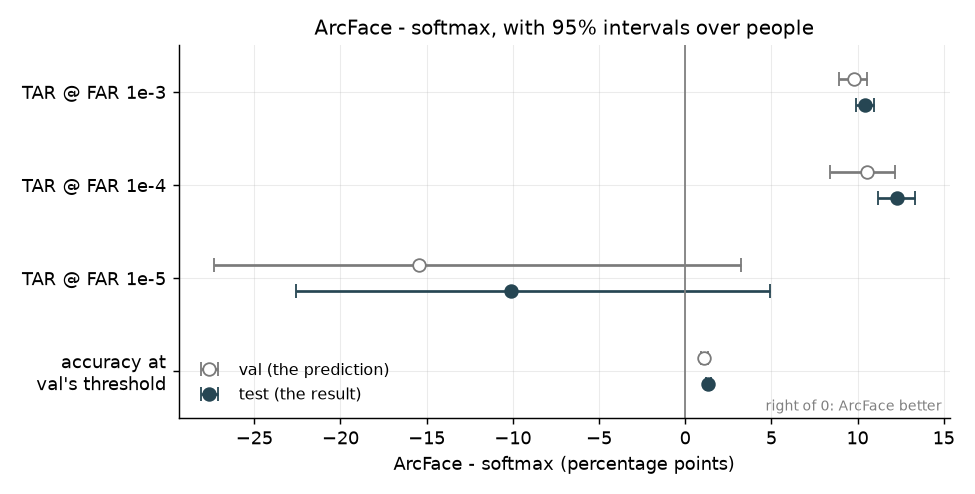

# Softmax vs ArcFace

The two models differ only in the training head. Everything else is the same:
DINOv2 ViT-S/14 plus a Linear + BatchNorm neck, CASIA-WebFace (9,072 training
identities), 10 epochs, and the same seed, data order, optimiser and schedule
(`scripts/train.py`). Both are judged on verifying people neither has seen:
the test split's 1,000 identities, 18,814 faces and 177M pairs of faces.

**Result.** ArcFace is clearly better at the settings a real system would use.
With a threshold set on val to let through 1 in 1,000 different-person pairs,
it accepts 72% of same-person pairs on test against softmax's 63%. Its
accuracy is also slightly higher, 91.9% against 90.5%. Only at the strictest setting, 1 in 100,000, is softmax
ahead, and not clearly: that comes from a cluster of low-quality faces that
ArcFace matches with each other.


Each curve shows how many same-person pairs a model accepts (up) for a given
share of different-person pairs it wrongly accepts (right). Higher is better.
The dots are the thresholds chosen on val, landing on test. They sit on their
dotted lines, so the false-accept rates set on val held for new people: within
0.9x to 1.4x of the target, for every model.

## Why ArcFace wins


- **Raw DINOv2** can barely tell people apart. Its two distributions overlap
  almost completely, because to the pretrained backbone any two faces look
  alike. Face training does nearly all the work.
- **Both trained models** put different people at a cosine of about 0, which
  is 90 deg apart. The difference is in the same-person distribution: ArcFace's
  sits further right, so more of it clears the threshold. Its margin keeps
  pulling a person's photos together after softmax has stopped. On training
  faces, the median angle to their own identity is 34 deg for ArcFace against
  57 deg for softmax.

## Predictions vs result



The hollow points are val, where the predictions came from. The filled points
are test. Only FAR = 1e-5's intervals cross 0.

### Predictions, written from val before test was used

1. ArcFace beats softmax at TAR@FAR = 1e-3 and 1e-4 by about 10 points, with
   intervals that never cross 0. On val: +9.8 [+9.0, +10.6] and +10.5 [+8.4, +12.2].
2. ArcFace beats softmax on accuracy at val's threshold by about 1 point.
   On val: +1.1 [+0.9, +1.3].
3. At FAR = 1e-5, ArcFace is not clearly better: the difference is negative or its
   interval crosses 0. On val: -15.5 [-27.4, +3.2]. The reason is ArcFace's
   cluster of low-quality faces ([low_quality_direction.md](low_quality_direction.md)).
4. Val's thresholds carry over. At FAR = 1e-3 and 1e-4, test's FAR is within a
   factor of 2 of the target. At 1e-5 it may be off by more.
5. Raw DINOv2 stays far below both, under 10% TAR at FAR = 1e-3 (3.4% on val).

These were committed (68e7752) before test was used. All five held:

1. +10.4 [+9.9, +10.9] at FAR = 1e-3, and +12.3 [+11.2, +13.3] at FAR = 1e-4.
2. +1.3 [+1.2, +1.5].
3. -10.1 [-22.6, +4.9]. The same cause showed up on new people: ArcFace's 1,768
   highest-scoring different-person pairs involve only 140 images, softmax's
   involve 2,034.
4. Test's FAR was 0.9x to 1.4x of the target, at every FAR level and for every model.
5. 3.4%.

## Numbers

TAR at test's own thresholds (as step 8 reported for val), and accuracy at the
threshold chosen on val:

| | TAR @ FAR 1e-3 | 1e-4 | 1e-5 | accuracy |
|---|---|---|---|---|
| DINOv2, no face training | 3.4% | 1.2% | 0.6% | 68.2% |
| softmax | 62.0% | 46.8% | **33.2%** | 90.5% |
| ArcFace | **72.4%** | **59.1%** | 23.1% | **91.9%** |

<details>
<summary>Thresholds chosen on val, applied to test</summary>

| | chosen for | threshold | test FAR | test TAR |
|---|---|---|---|---|
| softmax | FAR 1e-3 | 0.336 | 1.1e-3 | 62.7% |
| | FAR 1e-4 | 0.415 | 1.2e-4 | 47.9% |
| | FAR 1e-5 | 0.483 | 1.4e-5 | 35.1% |
| ArcFace | FAR 1e-3 | 0.362 | 1.0e-3 | 72.5% |
| | FAR 1e-4 | 0.453 | 9.0e-5 | 58.4% |
| | FAR 1e-5 | 0.666 | 8.6e-6 | 18.5% |
| DINOv2 | FAR 1e-3 | 0.758 | 1.4e-3 | 4.0% |

ArcFace's FAR 1e-5 threshold was pushed up by val's own low-quality cluster.
On test it is stricter than it needs to be (FAR 8.6e-6), and accepts 18.5% of
same-person pairs where 23.1% was possible.

</details>

## How they are compared

- **Test is used once for decisions.** Everything was developed on val, with
  `scripts/compare.py --eval-split val`, and the predictions were committed
  first. Later runs on test only fixed a GPU timeout and added a count and
  figures; the numbers were identical each time.
- **Thresholds come from val.** A deployed system fixes its threshold before it
  meets the people it will see.
- **A paired bootstrap over people** gives the intervals: resample identities with
  replacement, score both models on the same resample, keep the difference,
  1,000 times. The interval is the middle 95% of those differences. If it never
  crosses 0, the same model was ahead in nearly every resample, so the result
  doesn't depend on which people happened to be in the split. If it crosses 0,
  the resamples disagree about which model is ahead.
- **All pairs are scored,** with faces capped at 20 per identity so people with
  hundreds of photos don't dominate (as in step 8).

## What it doesn't show

- **Training randomness.** There is one training run per head. The intervals
  cover which test people are drawn, not how much a second training run with
  another seed would move the numbers.
- **What the margin alone contributes.** ArcFace differs from this softmax in
  two ways: it normalises embeddings and identity rows (with scale s = 64), and
  it adds the margin. A run with m = 0 (normalised softmax) would separate the two.
- **A general ranking.** This is one setting: ViT-S, CASIA-WebFace (0.5M noisy
  web images), 10 epochs, s = 64, m = 0.5. It is not a standard benchmark such
  as LFW.

## Reproduce

```bash
uv run scripts/compare.py                    # test, about 10 minutes; writes docs/img/test_*.png
uv run scripts/compare.py --eval-split val   # the dry run used during development
```
